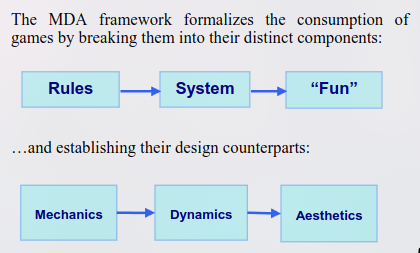

# Grand Strategy: *Designing a Historical Simulation Game*

![[maxresdefault.jpg]]

Year 12 Project Report

By

Dexter Jon Hart

5th November 2026

## Table of Contents

Table of Contents

Abstract
Introduction
Research
‌	Principles of Game Design
‌	Grand Strategy Games as a Genre
‌	Historical Simulation, Accuracy and Authenticity
‌	Player agency and Strategic Depth
‌	Analysis of Existing Grand Strategy Games
‌	Historical Context and Representation
Product Rationale
‌	Purpose and Target Audience
‌	Choice of Product and Format
‌	Structure, Presentation and Communication
‌	Application of Research and Design
Development and Production
‌	Initial Concept and Planning
‌	Historical Setting and World Design
‌	Development of Game Mechanics and Systems
‌	Creation of the Game Design Document
‌	Challenges, Changes and Refinement
Reflection and Evaluation
‌	Evaluation of Final Product
‌	Personal learning and development
‌	Limitations and Future Improvements
Conclusion
Refrences
Appendices

---

## 1 Abstract

COMPLETE AT END

## 2 Introduction

This report explores the principles and methods of game design, with a focus on grand strategy games. The guiding line of enquiry for this project is: _How do grand strategy games balance their historical accuracy, player agency, and strategic depth, and how can those approaches be applied in the design of my own game?_

This project was motivated by my interests in both history and software development, particularly the ability of games to simulate complex systems and allow players to engage with historical scenarios. The game concept developed for this project is set during the transition from the Late Roman world into the Early Medieval period, focusing on the migration of Frankish peoples and the rise of the Merovingian dynasty. This period provides a unique foundation for exploring the challenges of historical simulation, as players must navigate political fragmentation, cultural change, and the formation of new states.

The final product produced for this project is a Game Design Document (GDD), outlining the proposed mechanics, systems, and features of a historical grand strategy game. The document is intended for an audience interested in game design and historical strategy games, particularly those interested in understanding how complex historical systems can be represented through gameplay. Rather than producing a complete playable game, the GDD aims to communicate the overall design and provide a foundation for potential future development.

This report outlines the research which informed the ideas and decisions presented in the Game Design Document, the processes undertaken to develop the final product, and an evaluation of the project's outcomes and limitations.

## 3 Research

#### 3.1 Principles of Game Design

Game design is the development and arrangement of rules, mechanics, ans systems which influence how players interact with and experience the game. The fundamental principles of game design includes creating meaningful player choices, establishing clear rules and objectives, balancing challenges and reward, and providing feedback on consequences of player actions. With these principles aiming to create an engaging experience for players, and different theories and frameworks providing approaches to understanding how this can be achieved. 

Individual mechanics within a game establish what is possible, but their interconnecting interactions determines how a game develops and how players can respond. This relationship is explored through the Mechanics, Dynamics, and Aesthetics (MDA) framework, developed by Hunicke, LeBlanc, and Zebek (2004), and separates game design into its three interconnected components (see Figure 1). Mechanics describe the rules and systems of the game, dynamics the behaviour they present during gameplay, and aesthetic as the experience and response from the player (Hunicke, Leblanc & Zubek 2004). A fundamental aspect of this framework is the separation between the perspectives of the developers and players. Where developers construct the mechanics which form the game, and players experience the resulting dynamics and aesthetics (Hunicke, Leblanc & Zubek 2004).

Figure 1. Diagram showing connection between a players consumption and their design parallels (Hunicke, Leblanc & Zubek 2004). 

One of these fundamental principles is the importance of player decisions. Sid Meier explores this idea in his description of games as a series of 'interesting decisions'. Meier argues that these decisions are often meaningful and require negotiating trade-offs, risks, and consequences, where the effect of the choice depends on the player's circumstances. He uses an example which I have adapted to a strategy game lens, where investing resources into military expansion may provide an instantaneous advantage, but limits further economic growth (GDCVault & Meier 2012). Meier also emphasises in a 'Game Developers' report the importance of providing players with sufficient information and feedback to understand the consequences of their actions (Alexander 2012).

Although these approaches target different aspects of game design, they are connected through their relationship between mechanics and player experience. The MDA framework provides understanding on how systems induce gameplay, while Meier's focuses on the decisions those systems represent. Suggesting that a successful game design requires more than just numerous complex mechanics and systems. Instead they must interact to produce meaningful choices and an engaging experience. 

#### 3.2 Grand Strategy Games as a Genre

Grand strategy games are a subset of strategy games which focus on large-scale management of political entities, often across extensive geographic areas, and historical periods. Rather than concentrating on individual battles or tactical engagements, players make decisions concerning diplomacy, economics, warfare, politics, and the long-term development of their country or territory. This distinction is reflected in the broader concept of grand strategy, which involves the coordination of military, diplomatic, and economic resources towards a long-term political objective (Silove, 2018).

The genre emerged from earlier strategic board games and historical wargames, which attempted to simulate military conflicts and political circumstances through rules and mathematical logic. The transition from physical wargames to that of a digital grand strategy, is discussed by Loban in his report 'The transformation from physical wargames to grand strategy video games, and the opportunities for deep and efficient historical wargaming experiences', arguing that the computerising of the simulations removes the complexity of the earlier manual calculations and rules. Allowing historical strategy games to represent increasingly complex systems and interconnected systems, extending from simulating a single aspect to all of military, politics, economics, and social developments (Loban 2017). However, the greater complexity does not always equate to a more engaging experience, especially when additional mechanics increase the difficulty of understanding and increase the barrier to entry.

A defining characteristic of grand strategy games is its complex interactions between many systems. Military campaigns require economic resources, diplomatic influence political stability, and internal politics can limit the player's ability to pursue their objectives. Loban discusses grand strategy's ability to model diplomatic and international relationships as a significant element of the genre, simulating actions such as warfare, alliances, and trade deals between political entities (Loban 2017). Historical simulations and games, such as Crusader Kings and Europa Universalis series, use gameplay mechanics and a historical narrative to represent the past. Demonstrating the genre's ability to expand beyond military conflict, rather shifting to political and social developments (Spring 2014). Unlike its more common cousin, that of real time strategy games, which focuses heavily on controlling units and managing resources during individual engagements, grand strategy emphasises the broader political and strategic decisions over a longer period.

However, the systems used in historical strategy games can introduce an assumption on the player, one which is not reflective in historical realities. These assumptions include perfect information, perfect control, and perpetual conflict. These assumptions can simplify complex political relationships, perhaps in history where there were harsh negotiations for months to achieve peace, instead its a bar which says '100%', and an option of which land you take (de Zamaróczy 2016). It an represent a historical state as a much more unified and predictable entity, rather than its reality (de Zamaróczy 2016). Highlighting a limitation of the genre, as the mechanics which make a game understandable and manageable can eclipse the more complex realities, influencing how players interpret historical conditions.

Grand strategy games are particularly suited to historical simulation because they allow political, economic, and military developments to be represented as interconnected processes rather than isolated events. For the proposed game, set during the transition from the Late Roman world into the Early Medieval period, this provides an opportunity to represent political fragmentation and the formation of new states through interacting game systems. Consequently, the design must consider not only the historical circumstances being represented, but also how these systems influence player decisions and the development of alternative historical outcomes.

Should add more on the history, from kriegspel and how it was used by officers to practive before war. including its use still today.
https://militaryhistorynow.com/2019/04/19/kriegsspiel-how-a-19th-century-war-game-changed-history/
https://en.wikipedia.org/wiki/Kriegsspiel

#### 3.3 Historical Simulation, Accuracy and Authenticity

Historical simulation involves the representation of historical events, circumstances, and processes through systems which allow players to interact with the past. Unlike a traditional historical narrative, which presents events in an established sequence, historical simulation allows players to influence how events develop. However, these simulations are necessarily simplified interpretations of history, as the complexity of historical circumstances cannot be fully represented through the mechanics of a game. 

#### 3.4 Player Agency and Strategic Depth

How can interconnected systems create meaningful decisions without overwhelming the player? 

#### 3.5 Analysis of Existing Grand Strategy Games

What approaches from existing games are most relevant to the proposed design?

#### 3.6 Historical Context and Representation

Which historical characteristics of the Merovingian period should influence the game's mechanics?

## 4 Product Rationale

#### 4.1 Purpose and Target Audience

#### 4.2 Choice of Product and Format

#### 4.3 Structure, Presentation and Communication

#### 4.4 Application of Research and Design

## 5 Development and Production

#### 5.1 Initial Concept and Planning

#### 5.2 Historical Setting and World Design

#### 5.3 Development of Game Mechanics and Systems

#### 5.4 Creation of the Game Design Document

#### 5.5 Challenges, Changes and Refinement

## 6 Reflection and Evaluation

#### 6.1 Evaluation of Final Product

#### 6.2 Personal Learning and Development

#### 6.3 Limitations and Future Improvements

## 7 Conclusion

## References

Alexander, L 2012, _GDC 2012: Sid Meier on how to see games as sets of interesting decisions_, Game Developer, viewed 3 November 2026, <https://www.gamedeveloper.com/design/gdc-2012-sid-meier-on-how-to-see-games-as-sets-of-interesting-decisions>.

de Zamaróczy, N 2016, ‘Are we what we play? Global politics in historical strategy computer games’, _International Studies Perspectives_, vol. 18, no. 2, p. ekv010, viewed 3 November 2026, <https://doi.org/10.1093/isp/ekv010>.

Firaxis Games 2025, _Sid Meier’s Civilization VII_, 2k, viewed 3 November 2026, <https://civilization.2k.com/civ-vii/>.

Firaxis Games & Aspyr 2016, _Sid Meier’s Civilization VI_, 2k, viewed 3 November 2026, <https://civilization.2k.com/civ-vi/>.

GDCVault & Meier, S 2012, _Interesting Decisions_, Game Developers Confrence Vault, viewed 3 November 2026, <https://www.gdcvault.com/play/1015756/Do-Say-The-Right-Thing>.

Hunicke, R, Leblanc, M & Zubek, R 2004, _MDA: A formal approach to game design and game research_, _Association for the Advancement of Artificial Inteligence_, viewed 3 November 2026, <https://ocs.aaai.org/Papers/Workshops/2004/WS-04-04/WS04-04-001.pdf>.

Loban, R 2017, ‘Digitising diplomacy: Grand strategy video games as an introductory tool for learning diplomacy and international relations’, _DiGRA Digital Library_, viewed 3 November 2026, <https://dl.digra.org/index.php/dl/article/view/915>.

― 2021, ‘The transformation from physical wargames to grand strategy video games, and the opportunities for deep and efficient historical wargaming experiences’, _DIGITAL CULTURE & EDUCATION_, vol. 13, no. 1, p. 2021, viewed 3 November 2026, <https://static1.squarespace.com/static/5cf15af7a259990001706378/t/6140608f9c785f4271840181/1631608981678/Loban%2B2021.pdf>.

Paradox Development Studio, Lab42 & Lab42 Limited 2020, _Crusader Kings 3_, Paradox Interactive, viewed 3 November 2026, <https://www.paradoxinteractive.com/games/crusader-kings-iii/about>.

Paradox Development Studio & Tantalus Media 2016, _Stellaris_, Paradox Interactive, viewed 3 November 2026, <https://www.paradoxinteractive.com/games/stellaris/about>.

Paradox Development Studios 2016, _Hearts of Iron IV_, Paradox Interactive, viewed 3 November 2026, <https://www.paradoxinteractive.com/games/hearts-of-iron-iv/about>.

Paradox Tinto & Paradox Development Studio 2025, _Europa Universalis V_, Paradox Interactive, viewed 3 November 2026, <https://www.paradoxinteractive.com/games/europa-universalis-v/about>.

Spring, D 2014, ‘Gaming history: Computer and video games as historical scholarship’, _Rethinking History_, vol. 19, no. 2, pp. 207–221, viewed 3 November 2026, <https://www.tandfonline.com/doi/full/10.1080/13642529.2014.973714>.

## Appendices

#### Appendix A - BLA BLa

##### Rough Structure Idea

Aim 5200 ish words

Research -- 1900
Development -- 1450
Product Rationale -- 650
Reflection -- 550
introduction -- 300
conclusion -- 200
abstract -- 100

