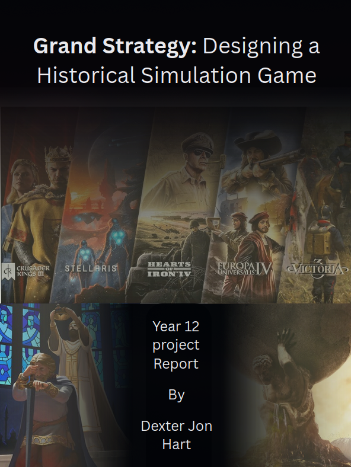
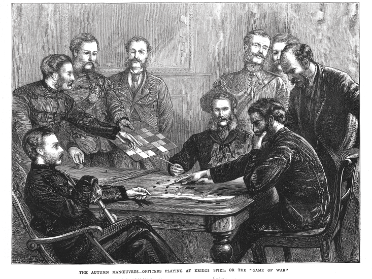
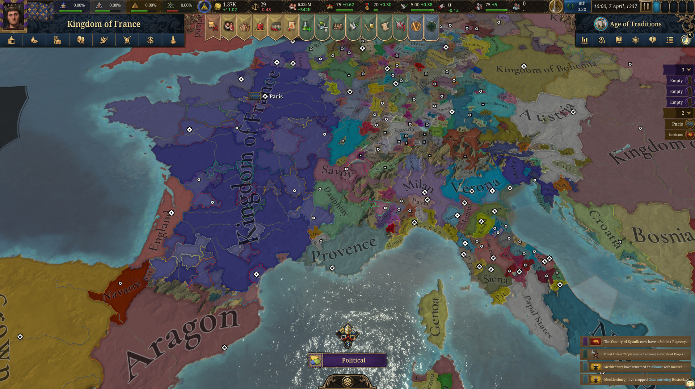
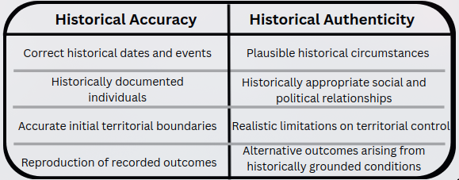
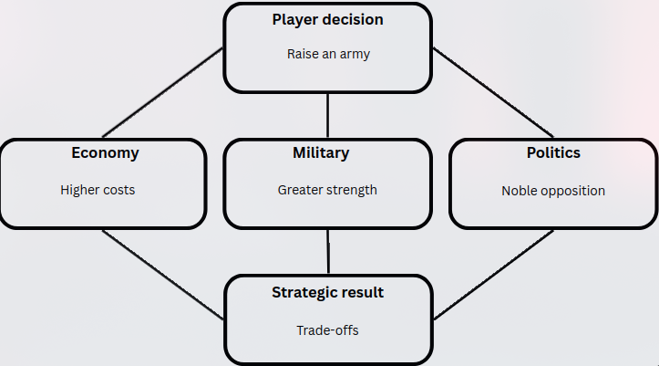
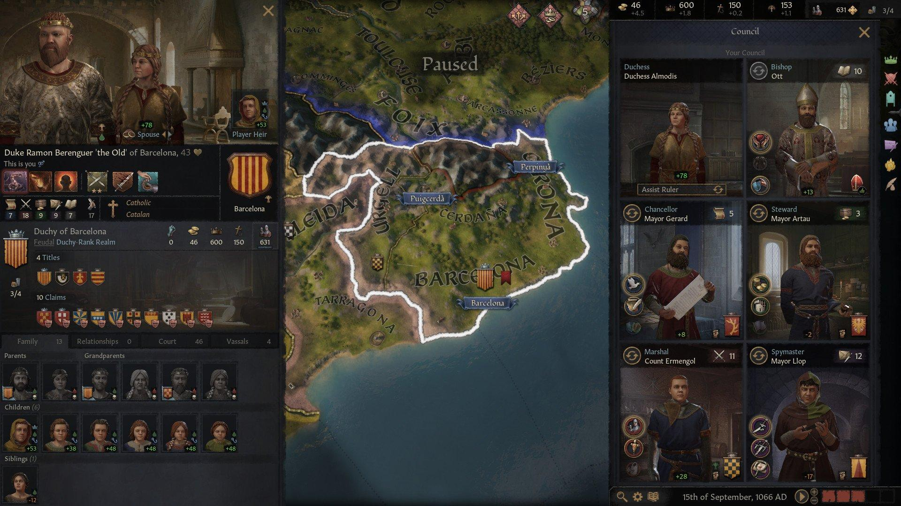
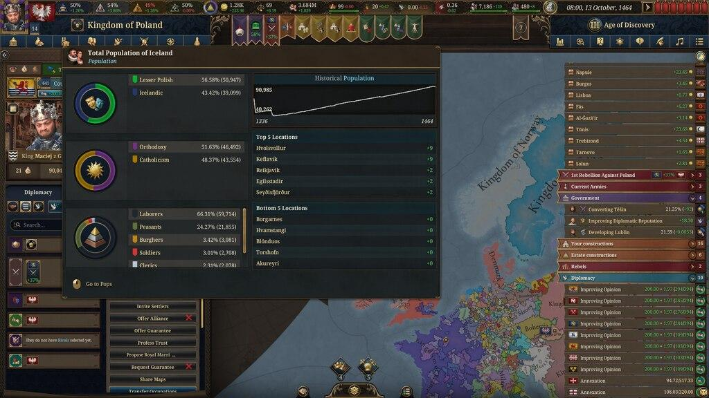
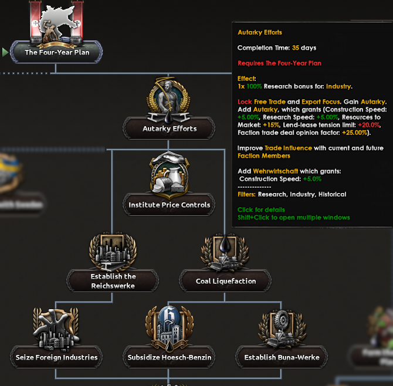

## Table of Contents

- [[#Table of Contents|Table of Contents]]  x / x
- [[#1 Abstract|1 Abstract]]x / x
- [[#2 Introduction|2 Introduction]]x / x
- [[#3 Research|3 Research]]x / x
		- [[#3.1 Principles of Game Design|3.1 Principles of Game Design]]x / x
		- [[#3.2 Grand Strategy Games as a Genre|3.2 Grand Strategy Games as a Genre]]x / x
		- [[#3.3 Historical Simulation, Accuracy and Authenticity|3.3 Historical Simulation, Accuracy and Authenticity]]x / x
		- [[#3.4 Player Agency and Strategic Depth|3.4 Player Agency and Strategic Depth]]x / x
		- [[#3.5 Analysis of Existing Grand Strategy Games|3.5 Analysis of Existing Grand Strategy Games]]x / x
- [[#4 Product Rationale|4 Product Rationale]]x / x
		- [[#4.1 Purpose and Target Audience|4.1 Purpose and Target Audience]]x / x
		- [[#4.2 Choice of Product and Format|4.2 Choice of Product and Format]]x / x
		- [[#4.3 Structure, Presentation and Communication|4.3 Structure, Presentation and Communication]]x / x
		- [[#4.4 Application of Research and Design|4.4 Application of Research and Design]]x / x
- [[#5 Development and Production|5 Development and Production]]x / x
		- [[#5.1 Initial Concept and Planning|5.1 Initial Concept and Planning]]x / x
		- [[#5.2 Historical Setting and World Design|5.2 Historical Setting and World Design]]x / x
		- [[#5.3 Development of Game Mechanics and Systems|5.3 Development of Game Mechanics and Systems]]x / x
		- [[#5.4 Creation of the Game Design Document|5.4 Creation of the Game Design Document]]x / x
		- [[#5.5 Challenges, Changes and Refinement|5.5 Challenges, Changes and Refinement]]x / x
- [[#6 Reflection and Evaluation|6 Reflection and Evaluation]]x / x
		- [[#6.1 Evaluation of Final Product|6.1 Evaluation of Final Product]]x / x
		- [[#6.2 Personal Learning and Development|6.2 Personal Learning and Development]]x / x
		- [[#6.3 Limitations and Future Improvements|6.3 Limitations and Future Improvements]]x / x
- [[#7 Conclusion|7 Conclusion]]x / x
- [[#References|References]]x / x
- [[#Appendix|Appendix]]x / x
		- [[#Appendix A - Game Design Document (GDD), template/examplar.|Appendix A - Game Design Document (GDD), template/examplar.]]x / x
		- [[#Appendix B - Screenshot of the Blizzard profile showing the name Merovingian.|Appendix B - Screenshot of the Blizzard profile showing the name Merovingian.]]x / x

---

## 1 Abstract

This project report investigates how grand strategy games balance their historical accuracy, player agency, and strategic depth, and how these principles can be applied to the design and development of a historical simulation game. The research focused on game design principles, how to handle historical representation, and an analysis of the approaches used in existing grand strategy games, particularly Crusader Kings III, Europa Universalis V, and Hearts of Iron IV. The designed game is set during the period between late Roman, and into the early Medieval, it focuses on the rise of the Franks and the Merovingians. Although initially intending to produce a playable game, the final product is a Game Design Document (GDD), outlining the proposed mechanics and systems. The project establishes the GDD's foundation for future development, while highlighting the challenges which come with designing a complex historical simulation.
## 2 Introduction

This report explores the principles and methods of game design, with a focus on grand strategy games. The guiding line of enquiry for this project is: _How do grand strategy games balance their historical accuracy, player agency, and strategic depth, and how can those approaches be applied in the design of my own game?_

This project was motivated by my interests in both history and software development, particularly the ability of games to simulate complex systems and allow players to engage with historical scenarios. The game concept developed for this project is set during the transition from the late Roman world into the early Medieval period, focusing on the migration of Frankish peoples and the rise of the Merovingian dynasty. This period provides a unique foundation for exploring the challenges of historical simulation, as players must navigate political fragmentation, cultural change, and the formation of new states.

The final product produced for this project is a Game Design Document (GDD), outlining the proposed mechanics, systems, and features of a historical grand strategy game. The document is intended for personal use as a framework for future development and, an audience interested in game design and historical strategy games. Rather than producing a complete playable game, or that of a prototype the GDD aims to communicate the overall design and provide a foundation for potential future development.

This report outlines the research which informed the ideas and decisions presented in the Game Design Document, the processes undertaken to develop the final product, and an evaluation of the project's outcomes and limitations.

## 3 Research

#### 3.1 Principles of Game Design

Game design is the act of defining rules, arrangements, mechanics, and systems which influence how a player or players interact within a game, and the experiences of the game. The fundamental principles of game design are first, create a meaningful set for player choices, establishing clear rules and objectives within the game, balancing the challenges and rewards for a player, and providing feedback on the consequences of player actions, be it good or bad. These principles aim to create an engaging experience for players, and the differing theories, and frameworks from game designers provide approaches to understanding how these principles can be achieved.

The individual mechanics which make up a game, establish what is possible within that game, and their interconnected interactions determine how a game can develop as played and how players can respond. With this relationship been explored through the Mechanics, Dynamics, and Aesthetics (MDA) framework, developed by game designers Hunicke, LeBlanc, and Zebak (2004), which separates game design into three interconnected components (See Figure 1).  Mechanics are the rules and systems within the game, dynamics the behaviour presented during gameplay, and aesthetic as the experience and the response of the player (Hunicke, Leblanc & Zubek 2004). A fundamental aspect of this framework is the separation between perspectives of the developers and the players. Where developers construct the mechanics and rules which define a game, the players experience the resulting dynamics and their aestherics (Hunicke, Leblanc & Zubek 2004). 

Figure 1. Diagram showing connection between a players consumption and their design parallels (Hunicke, Leblanc & Zubek 2004). 

One of the fundamental principles of game design is the importance of player decisions. With Sid Meier exploring this idea through his description of games as a series of 'interesting decisions'. Meier argues that decisions should and are often meaningful and require negotiating trade-offs, risks, and consequences, where the effect of this choice depends on the player's circumstances. He presents an example where investing in resources into military expansion, provides an instantaneous advantage, but limits further economic growth (GDCVault & Meier 2012). Meier also emphasises in a report from the 'Game Developers' the importance of providing players with a sufficient set of information and feedback to understand the consequences of their actions (Alexander 2012).

Although these approaches target different aspects of game design, they are connected through their relationship between mechanics and player experience. The MDA framework provides understanding on how systems induce gameplay, while Meier's focuses on the decisions those systems represent. Suggesting that a successful game's design requires more than just numerous complex mechanics and systems. Instead they must interact to produce meaningful choices and an engaging experience. 

#### 3.2 Grand Strategy Games as a Genre

Grand strategy is a sub-genre of the strategy games genre, which focuses on large scale management of political entities, such as countries, dynasties, or companies, often across an extensive geographical areas, from a continent to the world, and beyond, along with historical periods, or in general large periods of time, as there is nothing which defines grand strategy as historical. Rather then broader strategy games, which tend to focus on a single battle or series of battles, or tactical engagement. Players make decisions concerning diplomacy, economics, warfare, politics, and the long term development of their lands, or equivalent. It is separated even more from broader strategy by going beyond the focus on a single or few, in to the majority of the following,  military, diplomatic, and economic towards a common goal of long term political objectives (Silove, 2018).

The origins of the genre can be traced to earlier military simulations and historical wargames. Among the most influential of these was the Prussian _Kriegsspiel_, a professional wargame adopted by the Prussian army in the early nineteenth century. Schuurman (2021) explains that these wargames were used by officers as serious training tools rather than merely for entertainment, with players issuing written orders while an umpire interpreted outcomes and battlefield conditions. Julius (2021) similarly identifies the Prussian _Kriegsspiel_ as the first professional wargame, introduced into the Prussian army in 1824. These early systems are significant because they established many principles that would later influence strategy games, including map-based simulation, the modelling of military decision-making, and the attempt to represent complex real-world circumstances through rules and abstractions.

Figure 2. Prussian military officers practice fighting the next war with Kriegsspiel (Nash 1872).

The development from physical wargames to digital grand strategy games allowed these simulations to become much broader in scale and complexity. Loban (2021) argues that computerisation removed much of the burden of manual calculation and record-keeping which limited earlier wargames, allowing designers to represent more interconnected systems. As a result, historical strategy games expanded beyond the simulation of single battles to include political, economic, diplomatic, and social developments. However, greater complexity does not necessarily produce a more engaging experience, particularly when additional mechanics increase the difficulty of understanding the simulation and raise the barrier to entry.

A defining characteristic of grand strategy games is the interaction between multiple systems. Military campaigns require economic resources, diplomatic relationships influence political stability, and internal political circumstances can limit the player’s ability to pursue their objectives. Loban (2017) identifies diplomacy and international relations as significant elements of the genre, demonstrating how grand strategy games simulate alliances, warfare, and other interactions between political entities. Similarly, Spring (2015) shows that historical strategy games such as the _Crusader Kings_ and _Europa Universalis_ series use both gameplay mechanics and historical framing to represent the past. This demonstrates that the genre extends beyond military conflict alone, incorporating political and social developments as part of a broader simulation. Unlike real-time strategy games, which usually emphasise unit control and resource management during individual engagements, grand strategy games focus on broader political and strategic decision-making over longer periods.

Figure 3. Political map and user interface from *Europa Universalis V*, during a 'Kingdom of France' play though.(Paradox Interactive 2025).

However, the systems used in historical strategy games can also introduce assumptions which do not fully reflect historical realities. De Zamaróczy (2017) argues that many historical strategy games rely on assumptions such as perfect information, perfect control, and perpetual conflict. These mechanics can simplify political relationships and present historical states as more unified, rational, and predictable than they were in reality. This highlights a significant limitation of the genre, as the abstractions which make games understandable and playable can also shape, and sometimes distort, the player’s interpretation of the historical world.

Grand strategy games are particularly suited to historical simulation because they allow political, economic, and military developments to be represented as interconnected processes rather than isolated events. For the proposed game, set during the transition from the Late Roman world into the Early Medieval period, this creates an opportunity to represent political fragmentation and the formation of new states through interacting systems. Consequently, the design must consider not only the historical circumstances being represented, but also how these systems influence player decisions and the development of alternative historical outcomes.
#### 3.3 Historical Simulation, Accuracy and Authenticity

Historical simulation involves the representation of historical events, circumstances, and processes through systems which allow players to interact with the past. Unlike a traditional historical narrative, which presents events in an established sequence, historical simulation allows players to influence how events develop. However, these simulations are necessarily simplified interpretations of history, as the complexity of historical circumstances cannot be fully represented through the mechanics of a game. With Elliott (2017) arguing that these types of historical games can provide an opportunity for historical thinking through its simulation, rather than a simple reproduction of historical events.

An important distinction withing historical game design is that between historical accuracy and historical authenticity. With historical accuracy generally concerning the extent of which a presentation of history corresponds with evidence. While historical authenticity, is more concerned as to whether the presentation reflects the general characteristics, conditions, and experiences of the historical aspect. A game then can depart from recorded historical events, while maintaining its authentic representation of the period. The idea of evaluating a historical game purely from its accuracy of its content, overlooks the importance of its mechanics and the way a player interacts with the historical representation (Chapman 2012). 

Figure 4. Historical accuracy versus historical authenticity

This distinction is particularly important in grand strategy games, where players are able to influence political and military developments across extended historical periods. Strictly following recorded historical events could limit meaningful player decisions, while allowing unrestricted actions may undermine the historical circumstances which make up the setting. However, the systems themselves which are used to simulate historical circumstances can introduce their own inaccuracies. Assumptions within historical strategy games, include a perfect source of information, and control of resources, which simplifies the uncertainty and limitations faced by real historical leaders (De Zamaróczy 2017). Similarly, McCall (2012) recognises that a historical simulation requires the modelling of complex human behaviours which needs to be achieved though defined mechanical means, which will never truly reflect the real circumstances. Showing that these limitations around historical simulation cannot provide a complete and objective reflection of the past, and that the developers selection and design of mechanics influences the historical interpretation presented to the player.
#### 3.4 Player Agency and Strategic Depth

Player agency and strategic depth are two closely related principles of game design, particularly within grand strategy games, where players make decisions across numerous interconnected systems. Player agency refers to the ability of players to make meaningful decisions which influence the development and outcomes of a game, while strategic depth concerns the extent to which a game supports complex decision-making, long-term planning, and different strategies. However, providing players with more choices does not necessarily create greater strategic depth. 

Player agency emerges as a thoughtful balance between the actions available to the players and the constraints imposed by the game(Mateas 2001).  However, Tanenbaum (2010) challenges the linearity of this relationship, that greater freedom does not automatically equate to a greater agency, instead pushing the importance of a meaningful participation. These perspectives suggest that limiting player choices can encourage more deliberate and consequential decisions, rather than necessarily restricting the player's experience.

The strategic depth of a game is similarly dependent on the quality of decisions rather than the number of mechanics available.  Strategic depth through a game's capacity to sustain continued learning and strategic problem-solving (Lantz et al. 2017). Within grand strategy games, this can emerge through interconnected systems, where military expansion may provide territorial advantages but also increase economic costs and political instability. Consequently, players must consider both the immediate and long-term consequences of their decisions.

Figure 5. Example of interconnected strategic decisions.

#### 3.5 Analysis of Existing Grand Strategy Games

Existing grand strategy games provide valuable examples of how historical accuracy, player agency, and strategic depth can be balanced through different approaches to game design. Three particularly relevant examples are Crusader Kings III (2020), Europa Universalis V (2025), and Hearts of Iron IV (2016), developed by studios within Paradox Interactive. Although these games share several fundamental characteristics, they differ in the systems they prioritise and the ways players interact with their simulated worlds.

Crusader Kings III focuses primarily on characters, dynasties, and political relationships rather than the management of a unified state. Players control individual rulers and their successors, navigating relationships with vassals, family members, and neighbouring powers. Mechanics such as character traits, succession laws, marriages, and personal schemes create opportunities for political developments to emerge from interactions between characters (Paradox Development Studio, Lab42 & Lab42 Limited, 2020).  One of the game's greatest strengths is its ability to create personal narratives within a larger historical simulation. However, its emphasis on characters can come at the expense of detailed economic and population systems. This approach is particularly relevant to the proposed game, as personal loyalties and dynastic relationships were important characteristics of early medieval politics.

Figure 6. Crusader Kings III, with character menu open showing family and heir, and the council menu.

Europa Universalis V takes a broader approach, focusing on the management of societies and political entities through interconnected economic, diplomatic, and demographic systems. Its population-based model represents differences in culture, religion, and social position, while production, trade, and political estates influence the development of states (Paradox Interactive, 2025). Compared with Crusader Kings III, this provides a more detailed representation of the economic and social foundations of political power. However, such complexity can also increase the difficulty of understanding the consequences of individual decisions, potentially creating a greater barrier to entry.

Figure 7. Europa Universalis V, hovering over population showing the make up of people.

Hearts of Iron IV provides another approach, concentrating on warfare, industrial production, military logistics, and the strategic planning of the Second World War. Its national focus trees allow players to pursue historical or alternative political developments, while military and economic decisions determine their ability to conduct warfare (Paradox Development Studios 2016). Although this creates a strong relationship between strategic planning and military outcomes, its more structured historical pathways can restrict the range of developments that emerge naturally through gameplay.

Figure 8. Hearts of Iron IV, national focus tree snippet.

Despite these differences, all three games share several characteristics which define Paradox's approach to grand strategy. These include large-scale political maps, the management of interconnected systems, historical starting conditions, and the ability for players to influence the development of their chosen political entity. Rather than requiring players to achieve a single predetermined outcome, these games generally provide opportunities to establish their own objectives. However, the differences between their mechanics demonstrate that strategic depth can be achieved through different approaches, whether through character relationships, economic development, or military planning.

Grand strategy games are not necessarily historical, as demonstrated by Stellaris (2016), which applies many of these principles to a fictional science-fiction setting. Rather than beginning with established historical nations and circumstances, players can create their own interstellar civilisation, selecting characteristics such as its governing principles and species traits, before exploring a procedural generated galaxy (Paradox Development Studio & Tantalus Media 2016). Without the requirement to represent a particular historical period, the game has greater freedom to introduce unusual societies, technologies, and political circumstances. However, this freedom also requires the game to establish its own internal rules and consistency, rather than drawing upon historical circumstances to provide the foundations of its simulation.

Beyond Paradox Interactive, the Civilization series provides another significant approach to large-scale strategy gaming. Although primarily classified as 4X games, referring to exploration, expansion, exploitation, and extermination, Civilization VI (2016) and Civilization VII (2025) share many characteristics with grand strategy games. Both involve managing political entities across extensive periods, developing economic and military capabilities, researching technologies, and interacting with competing civilisations. However, unlike most Paradox grand strategy games, which generally begin with established historical political circumstances, Civilization typically begins with a relatively small settlement from which the player develops their society. This places greater emphasis on exploration, territorial expansion, and the gradual construction of a civilisation (Firaxis Games 2025).

Together, these games demonstrate that grand strategy can approach historical simulation and strategic decision-making through substantially different mechanics. Crusader Kings III provides a model for character-driven politics, Europa Universalis V demonstrates the potential of interconnected population and economic systems, and Hearts of Iron IV illustrates the consequences of structured historical progression and military planning. Stellaris highlights the greater creative freedom possible without a historical setting, while Civilization demonstrates how a more abstract historical progression can provide alternative approaches to strategy game design.

## 4 Product Rationale

#### 4.1 Purpose and Target Audience

The primary purpose of this project was to design and document the foundations of a historical grand strategy game, exploring how historical authenticity, player agency, and strategic depth could be balanced within a single simulation. The final product is a Game Design Document (GDD), outlining the proposed game's setting, core mechanics, and interconnected systems. Rather than producing a playable game, the document aims to communicate the overall design and provide a framework which could guide future development.

The primary intended audience of the GDD is myself, as I intend to eventually develop the proposed game into a playable product. The document serves as a reference for future development, allowing the design decisions, proposed mechanics, and overall vision of the game to be preserved and further refined. A secondary audience consists of those interested in understanding the proposed game, particularly enthusiasts of historical grand strategy games, and my peers. For this audience, the GDD aims to communicate the game's intended features, historical setting, and underlying design philosophy without requiring an understanding of its eventual technical implementation.

The document aims to address the need for a structured explanation of how different mechanics and historical considerations could be combined into a coherent game concept. By documenting these systems and their intended interactions, the GDD provides a foundation for further development, refinement, and eventual prototyping.

#### 4.2 Choice of Product and Format

The original intention of this project was to design and develop a playable historical grand strategy game. However, due to the complexity and scale of the proposed game, the final product was instead focused on producing a Game Design Document (GDD), outlining the game's overall concept, proposed mechanics, and systems. This change allowed greater attention to be placed on the theoretical and design aspects of the project, rather than attempting to develop a playable game within the available time frame.

A GDD was chosen as it provides a structured method of documenting the different components of a game, allowing individual mechanics to be explained alongside their relationships with other systems. This format is particularly appropriate for a grand strategy game, where the interactions between numerous systems are central to the gameplay experience. It also allows the design to be revised and expanded during future development, while preserving the reasoning behind earlier decisions.

However, the format also presents limitations. Without a playable prototype, the effectiveness of the proposed mechanics cannot be fully evaluated through gameplay testing, particularly in relation to game balance, player engagement, and the behaviour of interconnected systems. Despite these limitations, the GDD provides a more achievable and useful foundation for the project's long-term objective of developing a historical grand strategy game.

#### 4.3 Structure, Presentation and Communication

I structured the Game Design Document to communicate the proposed game's mechanics and overall design in a clear and organised manner. The document was divided into sections covering different aspects of the game, allowing individual systems to be explained separately while also establishing their relationships with other mechanics.

Throughout the document, I aimed to balance technical accuracy with accessibility, using game design terminology alongside explanations of the proposed mechanics. I also used headings and a consistent format for documenting individual features, including their descriptions, technical considerations, reasoning, and connections to other systems (see Appendix A). This structure allows information to be easily located and provides a reference for future development, while remaining understandable to readers unfamiliar with the proposed game. 

#### 4.4 Application of Research and Design

The research undertaken throughout this project influenced the design of the proposed game, particularly in determining which mechanics and systems would be included. My analysis of existing grand strategy games, particularly Crusader Kings III and Europa Universalis V, provided examples of different approaches to character relationships, political structures, economics, and population systems.

Research into historical accuracy, player agency, and strategic depth also influenced my overall design philosophy. I aimed to create a game where historical circumstances establish the foundations of the simulation, while player decisions and interactions between systems allow alternative historical outcomes to develop. These findings helped guide the proposed mechanics documented in the GDD, with an emphasis on meaningful decisions and interconnected systems rather than predetermined historical events.

## 5 Development and Production

#### 5.1 Initial Concept and Planning

My original intention for the Year 12 project was to design and develop a fully playable historical grand strategy game, focusing on the rise of the Franks and the Merovingian dynasty. The initial scope was ambitious, with the intention of creating a complete game, although using temporary artwork where necessary.

My initial planning involved using the whiteboard in the study room to brainstorm and organise potential features and mechanics. I also selected Godot as the game engine and began experimenting with the initial code. However, by the end of Term 1, I had made little progress towards developing the game, largely due to the time required for other school assignments. This led me to reconsider the scope of the project, initially reducing my ambitions to a limited playable prototype, before eventually focusing on the design and documentation of the game through a GDD.
#### 5.2 Historical Setting and World Design

I chose to focus on the rise of the Franks and the Merovingian dynasty, as it is an interesting historical period which is not extensively represented in commercially available grand strategy games. My initial interest in the period was also influenced by my father's Blizzard account name, 'Merovingian', which encouraged me to learn more about its historical origins (See Appendix B).

Initially, I intended the game to cover the entirety of Europe, but reduced its geographical scope to France, Italy, northern Spain, and parts of Germany, recognising that even this remained an ambitious undertaking. The game's setting focuses on the migration of the Frankish peoples, the establishment of their kingdom, and the transition from Roman to Germanic political and cultural influence.

These historical circumstances influenced my approach to designing the game's mechanics, combining character-driven politics similar to Crusader Kings III, population systems influenced by Europa Universalis V, and warfare mechanics inspired by Hearts of Iron IV to represent the challenges of migration and territorial expansion.
#### 5.3 Development of Game Mechanics and Systems

The development of the game's mechanics focused primarily on establishing the overall systems and how they could interact, rather than producing fully implemented mechanics. Drawing from my research into existing grand strategy games, I developed a general design direction combining character-driven politics from Crusader Kings III, population systems from Europa Universalis V, and military planning inspired by Hearts of Iron IV.

One of the central considerations was how these systems could represent the migration of the Franks and their eventual establishment of a kingdom. Population and cultural systems would provide a foundation for representing the movement and settlement of peoples, while character and political systems would influence the leadership and organisation of emerging states. Military mechanics would also need to account for the challenges of warfare and territorial expansion during migration.

However, these mechanics remained largely conceptual, with their exact rules, calculations, and interactions not fully established. As a result, their effectiveness could not be evaluated through implementation or gameplay testing. Nevertheless, outlining these systems helped establish the intended direction of the game and identify areas requiring further development.
#### 5.4 Creation of the Game Design Document

The creation of the Game Design Document involved organising the proposed game's ideas and mechanics into a structured format which could be used for future development. I developed a template for documenting individual features, including their descriptions, technical considerations, reasoning, and connections to other systems (see Appendix A).

This approach allowed me to establish a consistent method for recording design ideas, while also considering how individual mechanics would interact with the broader simulation. However, as the project shifted towards the GDD relatively late in its development, the document remained limited in its detail, with many proposed mechanics requiring further research and refinement. Despite this, the format provides a foundation which I can continue to expand during future development.

#### 5.5 Challenges, Changes and Refinement

The greatest challenge I encountered throughout the project was managing the scope of the game alongside my other school commitments. My original intention of developing a complete grand strategy game proved unrealistic within the available timeframe, particularly given the complexity of the interconnected systems I intended to include. By the end of Term 1, I had made little progress on the actual development of the game, requiring me to reconsider what could reasonably be achieved.

I initially reduced the scope to a limited playable prototype, before eventually deciding to focus on producing a Game Design Document. While this meant abandoning the original goal of creating a playable game, it allowed me to continue exploring the historical and game design aspects which initially motivated the project.

However, this change also introduced limitations, as the proposed mechanics remained largely conceptual and could not be tested or refined through gameplay. Although the final product is considerably different from my original intentions, reducing the scope allowed me to establish a foundation for future development rather than attempting to produce an incomplete game.
## 6 Reflection and Evaluation

#### 6.1 Evaluation of Final Product

The final product of this project was considerably different from my original intention of developing a playable historical grand strategy game. Although I would have preferred to produce a functioning game or prototype, I believe the Game Design Document represents a reasonable compromise given the time available and the scale of the original project.

The GDD provides a foundation for future development by establishing the overall concept, historical setting, and intended direction of the game's mechanics. However, its effectiveness as a development reference remains limited, as many of the proposed systems require more detailed explanations and their interactions have not been tested. While the document communicates the general vision of the game, it does not yet provide sufficient detail to guide its full implementation.

Overall, I consider the product partially successful in achieving its revised purpose, while recognising that considerable further development is required.
#### 6.2 Personal Learning and Development

Throughout this project, I developed a greater understanding of both game design and the historical period surrounding the rise of the Franks and the Merovingian dynasty. My research into existing grand strategy games helped me better understand how different mechanics and systems interact, and the challenges involved in balancing historical authenticity, player agency, and strategic depth.

One of the most significant lessons I learnt was the importance of establishing a realistic scope for a project. Initially, I underestimated the amount of time and work required to develop a game of this complexity, particularly alongside my other school commitments. While I was unable to achieve my original ambitions, the experience has given me a better understanding of the planning and preparation required for future software development projects.

#### 6.3 Limitations and Future Improvements

The greatest limitation of the final product is the lack of detailed and tested game mechanics. While the GDD establishes the overall concept and intended direction of the game, many systems remain in their early stages of design, with their interactions and balance yet to be explored. Without a playable prototype, it is also difficult to determine how effectively these mechanics would function together or whether they would create an engaging experience.

In the future, I intend to continue developing the GDD, expanding upon the proposed mechanics and their relationships before beginning work on a playable prototype. This would allow me to experiment with individual systems, identify problems, and refine the design through testing. Ultimately, I hope to use the foundations established through this project to eventually develop the historical grand strategy game I originally envisioned.
## 7 Conclusion

This project explored how grand strategy games balance historical accuracy, player agency, and strategic depth, and how these principles could be applied to the design of my own historical simulation game. Through my research, I found that achieving this balance requires more than simply recreating historical events or introducing complex mechanics. Instead, a successful historical grand strategy game should establish authentic historical circumstances, while allowing meaningful player decisions and interactions between systems to influence how events develop.

Although my original intention was to develop a playable game, the final product became a Game Design Document, outlining the foundations of the proposed game. While the document remains limited in its detail and requires further development, it allowed me to explore the relationship between history and game design, and establish a foundation for future work.

Overall, the project improved my understanding of historical simulation and the challenges of designing complex games, while providing a starting point for eventually developing the game I originally envisioned.

## References

Alexander, L 2012, _GDC 2012: Sid Meier on how to see games as sets of interesting decisions_, Game Developer, viewed 3 November 2026, <https://www.gamedeveloper.com/design/gdc-2012-sid-meier-on-how-to-see-games-as-sets-of-interesting-decisions>.

Chapman, A 2012, _Privileging form over content: Analysing historical videogames · Journal of Digital Humanities_, Journalofdigitalhumanities.org, viewed 3 November 2026, <https://journalofdigitalhumanities.org/1-2/privileging-form-over-content-by-adam-chapman/>.

de Zamaróczy, N 2016, ‘Are we what we play? Global politics in historical strategy computer games’, _International Studies Perspectives_, vol. 18, no. 2, p. ekv010, viewed 3 November 2026, <https://doi.org/10.1093/isp/ekv010>.

Firaxis Games 2025, _Sid Meier’s Civilization VII_, 2k, viewed 3 November 2026, <https://civilization.2k.com/civ-vii/>.

Firaxis Games & Aspyr 2016, _Sid Meier’s Civilization VI_, 2k, viewed 3 November 2026, <https://civilization.2k.com/civ-vi/>.

GDCVault & Meier, S 2012, _Interesting Decisions_, Game Developers Confrence Vault, viewed 3 November 2026, <https://www.gdcvault.com/play/1015756/Do-Say-The-Right-Thing>.

Henning, P 2021, ‘“Game on!” A research project on the prussian Kriegsspiel’, _British Journal for Military History_, vol. 7, no. 2, pp. 174–183, viewed 3 November 2026, <https://journals.gold.ac.uk/index.php/bjmh/article/view/1561?>.

Hunicke, R, Leblanc, M & Zubek, R 2004, _MDA: A formal approach to game design and game research_, _Association for the Advancement of Artificial Inteligence_, viewed 3 November 2026, <https://ocs.aaai.org/Papers/Workshops/2004/WS-04-04/WS04-04-001.pdf>.

Lantz, F, Isaksen, A, Jaffe, A, Nealen, A & Togelius, J 2017, _Depth in strategic games_, viewed 3 November 2026, <https://www.nealen.net/papers/Lantz2017Depth.pdf>.

Loban, R 2017, ‘Digitising diplomacy: Grand strategy video games as an introductory tool for learning diplomacy and international relations’, _DiGRA Digital Library_, viewed 3 November 2026, <https://dl.digra.org/index.php/dl/article/view/915>.

― 2021, ‘The transformation from physical wargames to grand strategy video games, and the opportunities for deep and efficient historical wargaming experiences’, _DIGITAL CULTURE & EDUCATION_, vol. 13, no. 1, p. 2021, viewed 3 November 2026, <https://static1.squarespace.com/static/5cf15af7a259990001706378/t/6140608f9c785f4271840181/1631608981678/Loban%2B2021.pdf>.

Mateas, M 2001, ‘A preliminary poetics for interactive drama and games’, _Digital Creativity_, vol. 12, no. 3, pp. 140–152, viewed 3 November 2026, <https://www.tandfonline.com/doi/abs/10.1076/digc.12.3.140.3224>.

McCall, J 2025, _» Historical simulations as problem spaces: Criticism and Classroom Use Journal of Digital Humanities_, Journalofdigitalhumanities.org, viewed 3 November 2026, <https://journalofdigitalhumanities.org/1-2/historical-simulations-as-problem-spaces-by-jeremiah-mccall/>.

Nash, J 1872, _The Autumn Manoeuvres, Officers playing at Kriegs Spiel, or the Game of War._, viewed 3 November 2026, <https://commons.wikimedia.org/wiki/File:Joseph_Nash_Kriegsspiel.png>.

Paradox Development Studio, Lab42 & Lab42 Limited 2020, _Crusader Kings 3_, Paradox Interactive, viewed 3 November 2026, <https://www.paradoxinteractive.com/games/crusader-kings-iii/about>.

Paradox Development Studio & Tantalus Media 2016, _Stellaris_, Paradox Interactive, viewed 3 November 2026, <https://www.paradoxinteractive.com/games/stellaris/about>.

Paradox Development Studios 2016, _Hearts of Iron IV_, Paradox Interactive, viewed 3 November 2026, <https://www.paradoxinteractive.com/games/hearts-of-iron-iv/about>.

Paradox Interactive 2025, ‘3D Map and UI Reveals’, _Paradox Forum_, 8 May, viewed 3 November 2026, <https://forum.paradoxplaza.com/forum/threads/3d-map-and-ui-reveals.1742852/>.

Paradox Tinto & Paradox Development Studio 2025, _Europa Universalis V_, Paradox Interactive, viewed 3 November 2026, <https://www.paradoxinteractive.com/games/europa-universalis-v/about>.

PNG Mart 2023, _Black fade, smooth transition, subtle shadow, dark gradient, deep toning PNG_, PNG Mart, viewed 4 November 2026, <https://www.pngmart.com/image/654127/png/654126>.

Schuurman, P 2019, ‘A game of contexts: Prussian-German professional wargames and the leadership concept of mission tactics 1870–1880’, _War in History_, vol. 28, no. 3, pp. 504–524, viewed 3 November 2026, <https://doi.org/10.1177/0968344519855104>.

Silove, N 2018, ‘Beyond the buzzword: The three meanings of “grand strategy”’, _Security Studies_, vol. 27, no. 1, pp. 27–57, viewed 3 November 2026, <https://openresearch-repository.anu.edu.au/server/api/core/bitstreams/81defc10-5119-4225-8f08-649e7d7545f7/content>.

Spring, D 2014, ‘Gaming history: Computer and video games as historical scholarship’, _Rethinking History_, vol. 19, no. 2, pp. 207–221, viewed 3 November 2026, <https://www.tandfonline.com/doi/full/10.1080/13642529.2014.973714>.

Stephenson, M, Perez-Liebana, D, Nelson, M, Khalifa, A & Zook, A 2019, _Game complexity vs strategic depth_, Um.edu.mt, National Institute of Informatics, Japan, viewed 3 November 2026, <https://www.um.edu.mt/library/oar/handle/123456789/82108>.

Tanenbaum, K & Tanenbaum, TJ 2010, ‘Agency as commitment to meaning: Communicative competence in games’, _Digital Creativity_, vol. 21, no. 1, pp. 11–17, viewed 3 November 2026, <https://doi.org/10.1080/14626261003654509>.

## Appendix

#### Appendix A - Game Design Document (GDD), template/examplar.

**Feature/Mechanic Name:** Lorem ipsum

**Tags:** Lorem, Ipsum

**Description:** Lorem ipsum dolor sit amet, consectetur adipiscing elit. Sed do eiusmod tempor incididunt ut labore et dolore magna aliqua. Ut enim ad minim veniam, quis nostrud exercitation ullamco laboris nisi ut aliquip ex ea commodo consequat. Duis aute irure dolor in reprehenderit in voluptate velit esse cillum dolore eu fugiat nulla pariatur. Excepteur sint occaecat cupidatat non proident, sunt in culpa qui officia deserunt mollit anim id est laborum.

**Technical:** Lorem ipsum dolor sit amet, consectetur adipiscing elit. Sed do eiusmod tempor incididunt ut labore et dolore magna aliqua. Ut enim ad minim veniam, quis nostrud exercitation ullamco laboris nisi ut aliquip ex ea commodo consequat. Duis aute irure dolor in reprehenderit in voluptate velit esse cillum dolore eu fugiat nulla pariatur. Excepteur sint occaecat cupidatat non proident, sunt in culpa qui officia deserunt mollit anim id est laborum.

**Reason:** Lorem ipsum dolor sit amet, consectetur adipiscing elit. Sed do eiusmod tempor incididunt ut labore et dolore magna aliqua. Ut enim ad minim veniam, quis nostrud exercitation ullamco laboris nisi ut aliquip ex ea commodo consequat. Duis aute irure dolor in reprehenderit in voluptate velit esse cillum dolore eu fugiat nulla pariatur. Excepteur sint occaecat cupidatat non proident, sunt in culpa qui officia deserunt mollit anim id est laborum.

**Connections:**
‌	Lorem Ipsum,
‌	Dolor sit,
‌	Consectetur

(Lorem Ipsum 2019)

#### Appendix B - Screenshot of the Blizzard profile showing the name Merovingian.

Figure B1. My father's Blizzard account, whose username first sparked my interest in the Merovingian dynasty.

